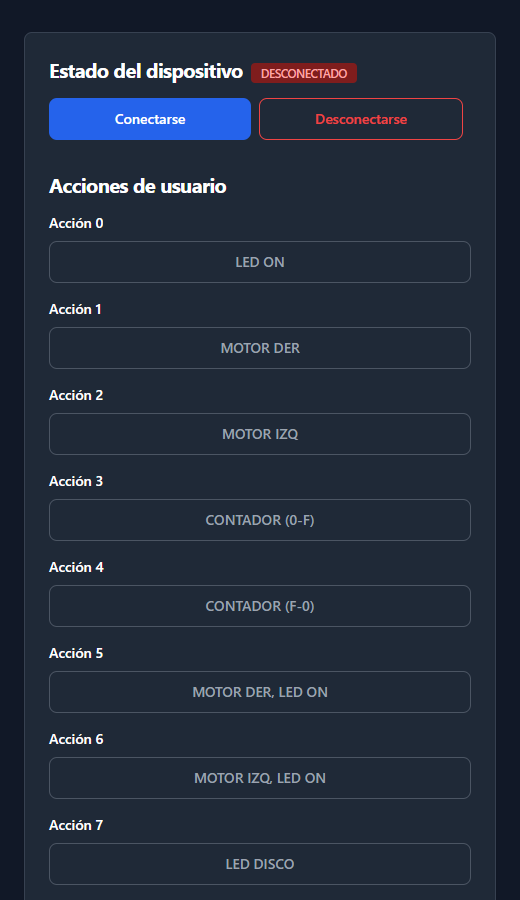

# Bluetooth Car Controller

**Web-based remote control for an ESP32 robotic car over Bluetooth Low Energy.**

<p align="center">
  
</p>

Bluetooth Car Controller was developed as a project for the *Sistemas Embebidos* (Embedded Systems) course of an engineering degree. It is a web application that connects directly from the browser to an ESP32 on board a robotic car using **Bluetooth Low Energy (BLE)** and the **Web Bluetooth API**. From a single page, the user can drive the motors and trigger the car's lights, sounds, counters and LED matrix animations in real time.

No native app, drivers or installation are required: the browser talks to the microcontroller directly, so the controller runs on any computer or Android phone with a compatible browser.

## Highlights

- **Direct browser-to-device communication.** Connects to the ESP32 through the Web Bluetooth API, without a backend server or intermediary.
- **Bluetooth Low Energy.** Uses the standard Nordic UART Service (NUS) for low-power, low-latency serial communication.
- **Real-time control.** Each command is sent instantly as a GATT write to the device.
- **Connection management.** Live connection status, automatic detection of disconnections and controls that are only enabled while the device is connected.
- **Responsive interface.** Built with Tailwind CSS, with automatic dark mode and a layout designed for both mobile and desktop.
- **Zero install.** A single HTML file that can be opened locally or published on any static host.

## How it works

```
┌──────────────────────┐        Bluetooth Low Energy         ┌──────────────────────┐
│      Web browser     │ ──────────────────────────────────▶ │        ESP32         │
│  (Web Bluetooth API) │   Nordic UART Service · GATT write  │   on the robotic car │
│                      │ ◀────────────────────────────────── │ motors · LEDs · sound│
└──────────────────────┘        connection status            │ display · LED matrix │
                                                             └──────────────────────┘
```

1. The user presses **Connect** and the browser shows the list of nearby Bluetooth devices, filtered to those named `ESP32`.
2. Once a device is selected, the app opens a GATT connection and gets access to the UART service.
3. The status badge changes to **CONNECTED** and all action buttons are enabled.
4. Each button sends a numeric command, encoded as UTF-8 text, to the ESP32's RX characteristic.
5. The ESP32 interprets the command and drives the corresponding outputs on the car.
6. If the connection is lost, the app detects it automatically, updates the status and disables the controls.

## Bluetooth profile

The communication uses the **Nordic UART Service (NUS)**, a widely adopted BLE profile that emulates a serial port over Bluetooth:

| Element | UUID |
| --- | --- |
| Service | `6E400001-B5A3-F393-E0A9-E50E24DCCA9E` |
| RX characteristic (write) | `6E400002-B5A3-F393-E0A9-E50E24DCCA9E` |

## Command set

| Code | Action |
| --- | --- |
| `0` | LED on |
| `1` | Right motor |
| `2` | Left motor |
| `3` | Up counter (0 → F) |
| `4` | Down counter (F → 0) |
| `5` | Right motor + LED on |
| `6` | Left motor + LED on |
| `7` | Disco LED sequence |
| `8` | Music + LEDs |
| `9` | Horn (beep) + left motor |
| `10` | RGB LED sequence |
| `11` | Horn (klaxon) + right motor |
| `12` | LED matrix: alphabet |
| `13` | LED matrix: on / off |
| `14` | LED matrix: square |
| `15` | LED matrix: "FIME-IEC" message |
| `16` | RGB LED: blue |
| `17` | RGB LED: green |
| `18` | RGB LED: red |

## Tech stack

- HTML5 + JavaScript
- [Web Bluetooth API](https://developer.mozilla.org/en-US/docs/Web/API/Web_Bluetooth_API) – BLE communication from the browser
- Bluetooth Low Energy – Nordic UART Service (GATT)
- [Tailwind CSS](https://tailwindcss.com/) – user interface
- ESP32 – BLE peripheral and car controller

## Getting started

Requirements:
- A browser with Web Bluetooth support: Google Chrome, Microsoft Edge or Opera on desktop, or Chrome on Android.
- Bluetooth enabled on the computer or phone.
- An ESP32 advertising as `ESP32` and exposing the Nordic UART Service.

Web Bluetooth only works in a secure context, so the page must be served over **HTTPS** or from **localhost**.

1. Clone the repository:

   ```bash
   git clone https://github.com/Alejandro095/bluetooth-car.git
   cd bluetooth-car
   ```

2. Serve the page locally:

   ```bash
   npx serve .
   ```

3. Open the URL shown in the terminal, press **Conectarse** and select the ESP32 from the list.

The page can also be published on GitHub Pages or any other static host with HTTPS to control the car from a phone.

## Author

**Javier Alejandro Monsivais Tovar**
